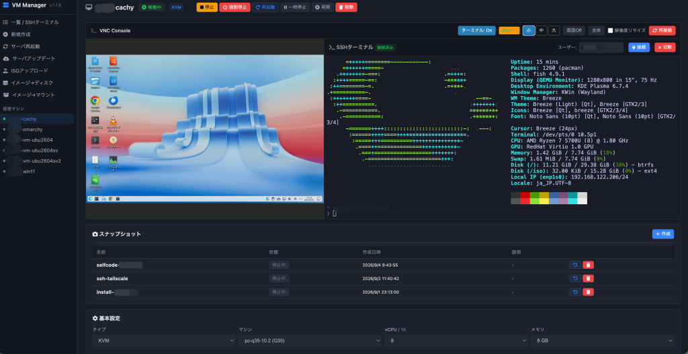

# VM Manager

libvirt / QEMU 上の仮想マシンを Web ブラウザから管理するための Web UI です（現在のバージョン: **v.2.4.0**）。

## 概要

- Python (Flask) + libvirt ベースの Web アプリケーション
- systemd サービス (`vm-manage`) として動作
- [Tailscale serve](https://tailscale.com) により HTTPS 化し、**Tailnet 内からのみ**アクセス可能
- アプリは `127.0.0.1:8090` のみで待ち受けるため、**LAN からは直接アクセス不可**
  - アプリ自体には認証機能がなく、アクセス制御は Tailnet（Tailscale アカウント）に依存します
- VNC 用の WebSocket 中継 (websockify) は `127.0.0.1:6080` で動作し、Tailscale serve の `/websockify` パスから同じ HTTPS エンドポイント経由で利用します
- SSHターミナルはブラウザ/タブを閉じてもセッション(sshプロセス)を維持し、再訪時に自動で再接続してスクロールバックも復元します（終了は「切断」ボタンで明示的に行います）



## 主な機能

### VM 一覧・ライフサイクル管理

- 一覧画面で全 VM（稼働中・停止中）の状態、vCPU、メモリ、マシンタイプ、ゲスト IP を確認
- 起動 / 停止（シャットダウン） / 強制停止 / 再起動 / サスペンド / レジュームをボタンで操作
  - 起動失敗時は AppArmor の seclabel や旧形式の Secure Boot 定義を自動修復して再試行し、VFIO/IOMMU 関連の失敗には原因ヒントを表示
- VM ごとの**ホスト起動時自動起動 (libvirt autostart)** をチェックボックスで即時切り替え
- 詳細画面は 3 秒ごとに状態をポーリングし、VM の状態変化で自動的に表示を更新

### VM の作成・編集

- フォームから新規 VM を作成、または **libvirt XML を直接貼り付けて**定義（XML 作成画面）
- 編集は詳細画面上の設定パネルから行い、UUID や既存 NIC の MAC アドレスを保持したまま再定義（停止中の VM のみ）
- 設定可能な項目:
  - ドメイン種別 (kvm/qemu)、アーキテクチャ (x86_64 / aarch64)、マシンタイプ（Q35 / i440fx 等を capabilities から取得）
  - vCPU / メモリ、ブート順序、複数のディスク（file / block / volume / network）、ISO CD-ROM
  - UEFI / **Secure Boot**、TPM (swtpm)、VNC / SPICE（TLS や各種オプション、**VNC キーマップ** en-us / ja）、ビデオ (virtio/qxl/cirrus)、サウンド (ich9)
  - ネットワーク（network / bridge / direct + モデル + MAC）、USB デバイス / PCI ホストデバイスのパススルー、USB リダイレクタ
- **Hyper-V 拡張**（relaxed / vapic / spinlocks / vpindex / synic / stimer / tlbflush / ipi 等）と **クロック調整** (`localtime`、RTC/PIT/HPET/TSC)、**CPU ピンニング** (cpuset) に対応
- Hyper-V 有効時に **Windows 11 向け高速化**を自動適用（`ioapic driver='kvm'`、TSC native、virtio ディスクの `discard='unmap'`、vhost-net マルチキュー）
- Secure Boot は Q35 系マシンタイプでのみ許可し、`<smm state='on'/>` を自動付与。`enrolled-keys=yes` は要求せず、`virt-fw-vars`（`virt-firmware` パッケージ）で VM ごとの NVRAM に Microsoft 証明書（2011/2023 世代）と VM 固有 PK を登録します。登録状態は詳細画面に表示され、未登録の既存 VM は編集保存時に登録されます
- 詳細画面から **XML の直接表示・編集** およびブート順序の変更が可能

### スナップショット

- 作成（名前自動生成: `snap-YYYYmmdd-HHMMSS`）/ 一覧 / 復元 / 削除に対応
- VM を削除する際は、関連するスナップショットを先にすべて削除してから undefine します（NVRAM も削除可）

### ディスク・デバイス操作（詳細画面）

- ディスクの追加（新規 qcow2 作成 or 既存 XML）、切り離し、サイズ拡張（`qemu-img resize`）、順序変更
- ISO の eject / ソース変更（`virsh change-media --live --config`）
- USB デバイス（`lsusb` から選択）のアタッチ / デタッチ、PCI ホストデバイスのアタッチ / デタッチ
- ストレージプール、ブロックデバイス (`lsblk`)、ISO/qcow2 イメージ一覧を参照可能

### VNC コンソール (noVNC)

- 詳細画面に埋め込み表示、または standalone コンソール画面 (`/vm/<name>/console`) で利用
- 自動再接続、**半角/全角キー送信**（物理スキャンコード `Backquote` 0x29）、**英数キー送信**（`CapsLock` 0x3a / XK_Eisu_toggle）、**Ctrl+Alt+Delete** 送信
- **クリップボード送信**（`ClientCutText`）: HTTPS 環境では OS のクリップボードを直接読み取り、不可の場合はテキスト入力ダイアログにフォールバック（ゲスト側への一方向）
- VNC のキーマップを VM ごとに `en-us` / `ja` から選択可能（keysym → 物理キー変換テーブル。ゲスト側のキーボードレイアウトと合わせて設定）
- 画面サイズのプリセット（小/中/大、localStorage に保存）、全画面表示、「画面Off」オーバーレイ、解像度リサイズ切替

### SSH ターミナル

- xterm.js ベースのブラウザターミナルでゲスト OS に SSH 接続
- ブラウザ/タブを閉じても SSH セッションはバックエンドで生存し、再訪問時に自動で再接続してスクロールバック（最大 256 KB）を復元
- 明示的な「切断」操作でのみセッションを終了
- 一覧画面・詳細画面の両方から利用可能

### GPU パススルー / 単一 GPU 強制パススルー

- VFIO ドライバにバインドされた PCI デバイスを VM に割り当て可能
- **単一 GPU 強制パススルー**: ホストの GPU を 1 台だけ VM に割り当てる構成を自動セットアップ
  - IOMMU / VFIO / ブートローダ (limine / grub) の事前検査（実現不可時は有効化を拒否、Intel iGPU の `probe error -22` は警告）
  - `/etc/modprobe.d/`、`/etc/modules-load.d/`、`mkinitcpio` / `limine` の drop-in を書き込み、initramfs を再ビルド（再起動が必要な場合あり）
  - libvirt の qemu フックでホストのコンソール/ディスプレイマネージャを停止・復元し、同一スロットのオーディオ機能もまとめてパススルー
  - `kvm hidden state=on` や `ioapic driver='kvm'` を定義に追加。作業内容は `/opt/vm-gpu.md` に記録

### serv / cachy-UI 連携

- 起動中の VM の Tailnet ホスト名（または Tailnet IP）を解決し、ポート **3355** の応答を確認して `https://<vm>.<tailnet>:3355` を開くボタンを一覧・詳細画面に表示

### ISO / qcow2 管理（サイドバー「ISO/qcow2管理」）

- ブラウザから `.iso` / `.qcow2` / `.img` をアップロード（進捗バー付き、空き容量チェック）
- URL からの Web ダウンロード（進捗表示・キャンセル可、同時 1 件）
- VM のディスクとして使用中のファイルは削除不可

### イメージツール

- **イメージ→ディスク**: qcow2/img を物理ディスク (`/dev/...`) に書き込み（`qemu-img convert` / `dd`、サイズ・マウント状態を検査し、パス入力で確認）
- **イメージ→マウント**: qcow2 を `qemu-nbd`（必要なら raw 変換 + loop）で接続し、パーティションごとに `/opt/vm/mnt-img*` へマウント。状態確認・安全なアンマウント（`busy_blockers()` で占有プロセスを表示）に対応

### サーバ運用・ネットワーク

- サイドバーから **サーバ再起動** と **サーバアップデート** を実行（更新完了後に自動再起動、実行ログを表示。ディストリビューションはログ先頭の `[distro: ...]` で確認可）
- ネットワーク一覧（状態・autostart・ブリッジ・DHCP リース数）と、UFW / firewalld の `virbr0` 例外を自動適用する修復 API

## インストール方法

インストールスクリプトを GitHub からダウンロードして、root で実行します。
Debian/Ubuntu と Arch/CachyOS を自動判別し、パッケージ管理 (`apt` / `pacman`) を使い分けます。

```bash
curl -fsSL -o /tmp/install-vmmanager.sh \
  https://raw.githubusercontent.com/hirogura/vmmanager/main/install-vmmanager.sh
chmod +x /tmp/install-vmmanager.sh
sudo /tmp/install-vmmanager.sh
```

※ 旧スクリプト名 (`install-vmmanager1.sh`) でも実行できます（統合スクリプトへ転送されます）。

### 対応ディストリビューション

- Debian / Ubuntu 系 (`apt` を使用)
- Arch / CachyOS 系 (`pacman` を使用。`edk2-ovmf` / `swtpm` / `dnsmasq` / `virt-firmware` 等の Arch パッケージ名に対応)

アプリ本体 (`app.py`) も実行時に OS 差異を自動吸収します（`/etc/os-release` による判別 + 実在ファイルの検出）:

- OVMF パス: Debian (`/usr/share/OVMF/OVMF_CODE_4M*.fd`) と Arch (`/usr/share/edk2/x64/OVMF_CODE*.4m.fd`) の両方から実在ファイルを検出
- Secure Boot: `secure-boot` のみ要求し `enrolled-keys=yes` は付けない（CachyOS/Arch のファームウェア記述子に `enrolled-keys` が無く define 失敗するため。Debian/Ubuntu でも同一テンプレートが選ばれる）。`<smm state='on'/>` を自動付与し、Q35系以外のマシンタイプでは作成・編集時にエラーを返す。旧形式の定義は起動時に自動修復する。CachyOS/Arch の VARS テンプレートは鍵未登録（空ストア）のため、SB 要求時は `virt-fw-vars`（`virt-firmware` パッケージ）で VM ごとの NVRAM へ鍵登録する（MS 証明書 2011+2023 世代を内包・VM 固有 PK を自動生成。生成 PK の秘密鍵は保持されない）。自前実装（v1.6.0）では db のベンダーGUID を誤っており MS 署名ブートローダが起動できなかったため v1.6.1 で参照実装に委譲した。未登録の既存 VM は詳細画面に「鍵未登録のため未実施」と表示し、編集保存で登録される
- `<seclabel model='apparmor'>`: AppArmor が有効なホストでのみ付与（CachyOS では省略し libvirt の自動付与に任せる）
- ボリュームの所有者: `libvirt-qemu:kvm` → `libvirt-qemu:libvirt` → `qemu:kvm` → `root:kvm` の順にフォールバック
- noVNC / websockify: `/usr/share/novnc`・`/usr/share/webapps/novnc`・`PATH` 上の `websockify` 等から自動検出

### インストールスクリプトが行うこと

1. システムパッケージのインストール（Python, libvirt, QEMU, noVNC など。Arch 系では `pacman`）
2. `libvirtd` サービスの有効化（+ 既定 NAT ネットワーク `default` の自動起動）
   - ネスト VM 等で `192.168.122.0/24` が衝突する場合は空いているサブネットで再作成
   - `virbr0` に対する UFW / firewalld の例外を追加
3. ストレージプールの設定
   - Btrfs 上では事前に `/opt/vm` をサブボリュームとして作成します
     （snapper の親スナップショットから除外して肥大化を防ぐ + `chattr +C` / `compression none` で COW・圧縮を無効化し qcow2/raw の断片化を防ぐ）
     - 既に通常ディレクトリとして存在する場合: 空なら置き換え、非空なら `/opt/vm.bak.YYYYMMDDHHMMSS` に退避してから作成します
     - ネストしたサブボリュームのため `/etc/fstab` の追記は不要です
   - デフォルトプール `default` を `/opt/vm` に向けます（`/opt/vm` が無ければ作成します）
   - `/iso` ディレクトリが存在する場合は `iso` プールとして追加します
4. Tailscale のインストール（未導入の場合。Arch 系では `pacman -S tailscale`）
5. GitHub リポジトリからアプリ本体を `/opt/vm-manage` に取得
6. Python 仮想環境と Flask のセットアップ（`--system-site-packages` で `libvirt` バインディングを共有）
7. `websockify`（pip）と noVNC（Arch 系では GitHub から `/usr/share/novnc` へ配置）のセットアップ
8. systemd サービス (`vm-manage.service`) の作成・起動
9. `tailscale serve` でポート `8090` を HTTPS 公開（Tailnet 内のみ）
   - さらに `/websockify` を VNC コンソール（WebSocket）用に同じ `8090` 上で公開

> サイドバーの「サーバアップデート」は統合スクリプト (`install-vmmanager.sh`) を再実行します。
> 実行中のディストロは更新ログの先頭（`[distro: ...]`）で確認できます。

### アクセス方法

インストール完了時に表示される URL からアクセスします。

```
https://<マシン名>.<テイルネット名>.ts.net:8090
```

例: `https://myhost.my-tailnet.ts.net:8090`

- アクセスできるのは **同じ Tailnet にログインしている端末のみ** です
- HTTPS 証明書は Tailscale が自動で発行します
- Tailscale に未ログインの場合は、初回実行時に `tailscale up` の認証が必要です
  （表示される URL をブラウザで開いてログインしてください）

## アンインストール方法

サービスとアプリ本体を削除します。

```bash
sudo systemctl stop vm-manage.service
sudo systemctl disable vm-manage.service
sudo rm -f /etc/systemd/system/vm-manage.service
sudo systemctl daemon-reload
sudo rm -rf /opt/vm-manage
```

Tailscale serve の公開設定も削除する場合:

```bash
sudo tailscale serve --https=8090 off
sudo tailscale serve --https=8090 --set-path=/websockify off
```

Tailscale 自体をアンインストールする場合:

```bash
sudo tailscale logout
# Debian/Ubuntu
sudo apt remove -y tailscale
# Arch/CachyOS
sudo pacman -R tailscale
```

※ VM 本体（libvirt で管理されている仮想マシンやディスク）は削除されません。仮想マシン自体を削除する場合は別途 `virsh` などを使用してください。

## 開発

```bash
cd /opt/vm-manage
python3 -m venv --system-site-packages venv
venv/bin/pip install flask flask-sock simple-websocket websockify
venv/bin/python app.py   # http://127.0.0.1:8090
```

## ライセンス

このプロジェクトは [MIT License](LICENSE) の下で公開されています。
